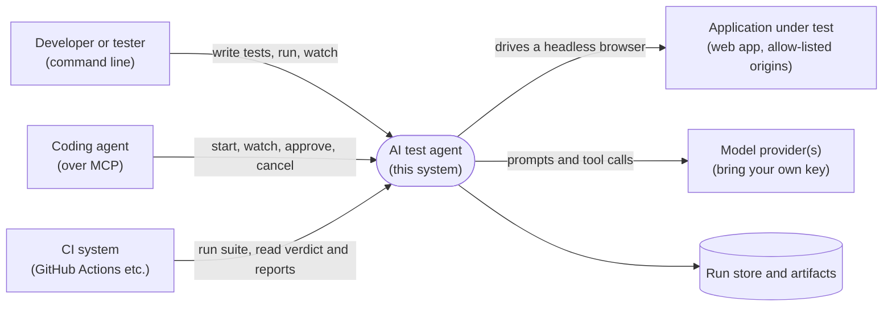
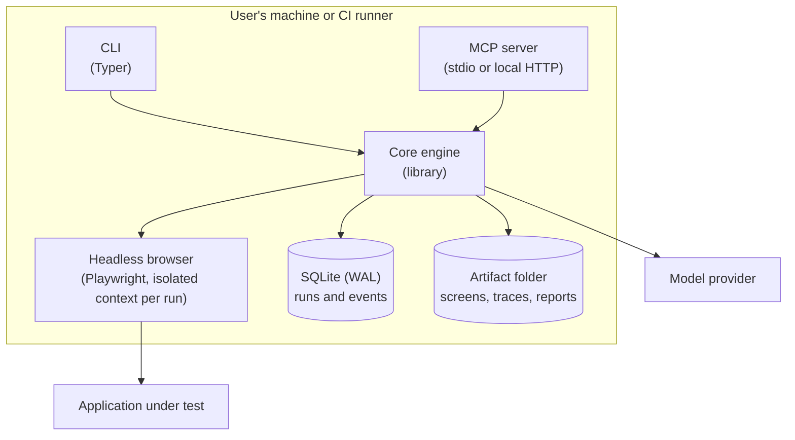
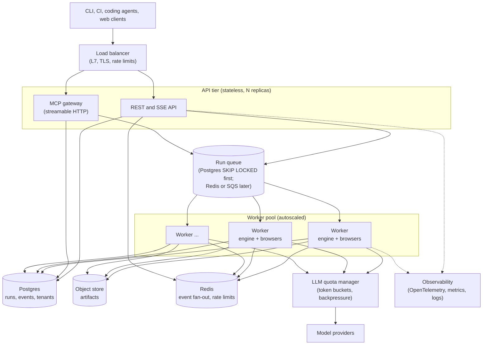
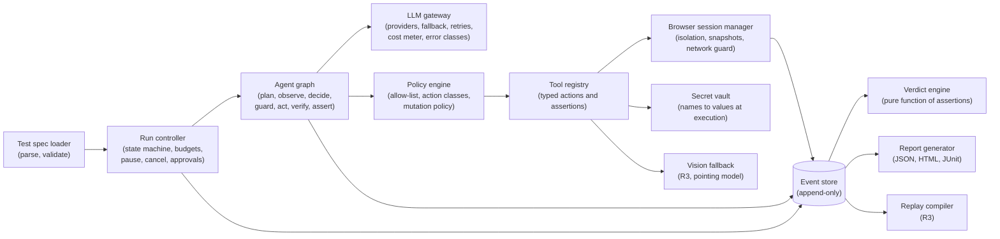
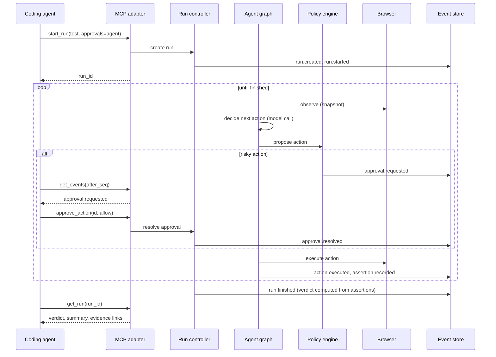

# High-level design (HLD)

Status: Draft v0.1. Satisfies [requirements](../02-requirements.md). Details of each part are in the
[LLD](lld.md), [interfaces](interfaces.md), [security](security-threat-model.md) and
[scaling and operations](scaling-and-operations.md). Decisions behind it: ADR-0009 to ADR-0013 in the
[decision log](../decisions/README.md).

Diagrams are [Mermaid](https://mermaid.js.org/), rendered natively by GitHub. A standalone image of the overview is
in `docs/diagrams/overview.svg`.

## 1. Design principles

1. **Ports and adapters.** A pure core (run engine, agent loop, verdict engine) with thin adapters for everything that
   touches the world (CLI, MCP, REST, browser, model providers, storage). The core never imports an adapter.
2. **Everything is an event.** A run is an append-only event log. State, reports, live views and replays are derived
   from it. This gives supervision, resumability and auditability with one mechanism.
3. **The verdict is computed.** A deterministic function over recorded assertions; the model cannot override it.
4. **Safe by default, in layers.** Allow-list, action classes, approvals, secret placeholders, budgets, isolation. No
   single layer is trusted to be perfect.
5. **Local-first, service-ready.** The same engine runs in one process (local and CI modes) and in a worker pool
   (service mode). Service mode is *designed* now and *built* only when needed.
6. **Boring technology.** Prefer well-understood parts (Playwright, SQLite and Postgres, plain HTTP) over novel
   infrastructure, and add a part only with a written reason.

## 2. System context (who and what it talks to)

## 3. Containers

### 3.1 Local and CI mode (R1 to R4): one process, no server

### 3.2 Service mode (R5): scalable, designed now and built on demand

The two modes share the core engine. What changes is the storage adapter (SQLite or Postgres, folder or object store)
and the way runs are scheduled (in-process or via the queue).

## 4. Components of the core engine

Every arrow into the event store is an append. The verdict engine and the report generator only *read* events.

## 5. Key flow: one run, supervised by a coding agent

## 6. Deployment modes

| Mode | Where it runs | Scheduling | Storage | Use |
|---|---|---|---|---|
| **A: Local** | Developer machine | In-process | SQLite plus folders | Writing tests, debugging, personal use |
| **B: CI** | CI runner (container or VM) | In-process, one process per job | SQLite plus uploaded artifacts | Regression runs on every pull request; exit code and JUnit |
| **C: Service** | Containers behind a load balancer | Queue and worker pool | Postgres plus object store | Teams, schedules, many tenants (R5, on demand) |

## 7. Technology choices

Each is a decision with an alternative; those marked **spike** are verified by a small measured spike before commitment.

| Concern | Choice | Why | Alternative and why not (now) |
|---|---|---|---|
| Language | Python 3.12+ | Owner's strength; best agent and test ecosystem | TypeScript: Playwright's home, but a second language to maintain |
| Browser control | Playwright for Python | Accessibility snapshots, tracing, isolation, active project | Selenium: older model; Puppeteer: Chromium only |
| Observation | Accessibility-tree snapshot first, screenshot plus vision as fallback | Cheaper and more reliable than pixels; reuses earlier pointing work as fallback | Vision-only: measured at about 80% per small control, too weak as the primary |
| Agent orchestration | LangGraph (graph, interrupts, checkpoints) | Approval pauses and resume are first-class; carries over from the earlier backend | Hand-written loop: simpler, but we would rebuild pausing and checkpointing |
| Models | Provider-neutral through LangChain chat models; BYOK; primary plus fallback | Already built and tested; avoids lock-in | Direct SDKs: lock-in |
| Data models | Pydantic v2 | Validation and JSON Schema for tests, events and APIs | dataclasses: no validation |
| CLI | Typer | Typed, minimal | argparse: more code |
| MCP | The official `mcp` Python SDK (**spike**: compare the standalone `fastmcp`) | Fewer moving dependencies | `fastmcp`: more features, faster-moving |
| Local storage | SQLite in WAL mode plus a folder per run | Zero setup; durable; transactional | Files only: no queries or atomic appends |
| Service storage | Postgres plus S3-compatible object store | Standard, scalable, managed options exist | Document stores: no need |
| Queue | Postgres `SELECT ... FOR UPDATE SKIP LOCKED` first | No new infrastructure; transactional with run state | Redis, SQS or Kafka: add when throughput or latency demands it (see scaling) |
| Event fan-out | Postgres `LISTEN/NOTIFY` first, Redis pub/sub at scale | Same reasoning | Kafka: far more than needed |
| Containers | Docker; Compose first, Kubernetes with autoscaling only if needed | Deployment last, as decided | Orchestrators from day one: premature |
| Observability | OpenTelemetry, Prometheus metrics, Grafana | Vendor-neutral standards | Vendor agents: lock-in |
| CI/CD | GitHub Actions | Where the code lives | Other CI: no benefit |

## 8. Cross-cutting concerns

- **Configuration:** environment variables and an optional file, validated at start with Pydantic (fail fast).
- **Logging:** structured JSON, always with `run_id`; never logs secrets, page content beyond the step log, or model keys.
- **Errors:** a small, classified taxonomy (see [LLD](lld.md)): *test failure* is a result, *infrastructure error* is an error.
  Provider errors are classified (rate limit, timeout, invalid request) and retried or fallen back accordingly.
- **Versioning:** the test-file format, event schema and public APIs carry explicit versions; breaking changes follow
  the deprecation rule (NFR-14).
- **Time and cost bounding:** every loop, call and run has a budget and a timeout.

## 9. How the design meets the key qualities

| Quality (requirement) | Mechanism |
|---|---|
| Trustworthy verdicts (NFR-01, FR-21) | Verdict engine is a pure function of assertions; "inconclusive" is first-class; model-judged assertions flagged |
| Repeatability (NFR-02) | Temperature 0, stable element references, verification after each action, replay scripts in R3 |
| Safety (NFR-05, FR-50 to FR-56) | Layered policy, isolation, secret placeholders, injection canaries |
| Supervisability (G6) | Event stream plus controls; adapters stateless; same engine for all modes |
| Recoverability (NFR-12) | Events are the source of truth; checkpoints allow resume; docs allow cold start |
| Scalability (NFR-11) | Stateless API tier, queue-based workers, quota-aware backpressure (see scaling) |
| Cost (NFR-04) | Budgets, snapshot trimming, replay mode, model fallback ordering |

## 10. Risks and open design questions

| Risk or question | Response |
|---|---|
| Snapshots may not expose enough on some pages (canvas, custom widgets) | Vision fallback (R3); measure how often on the suite |
| Model latency (2 to 17 s observed) makes tests slow | Budget per test; replay mode; fallback model; parallel runs |
| LangGraph or MCP APIs change | Adapters at the edges; pinned versions; spike before commitment |
| Event sourcing adds complexity | Kept deliberately small: one append-only table and pure projections |
| Too much service design for a solo project | Service mode is documented only; built on demand (R5 gate) |
