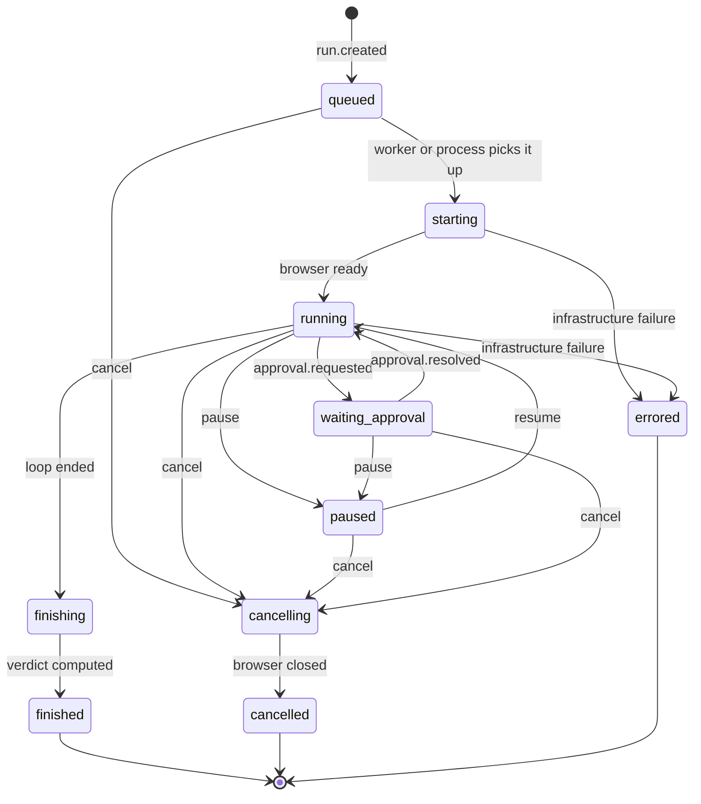
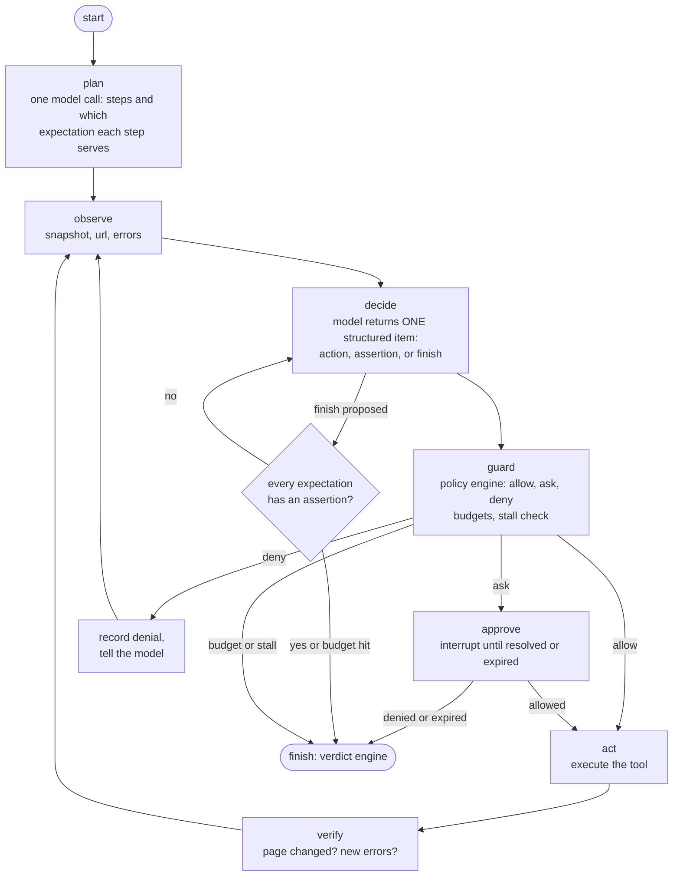

# Low-level design (LLD)

Status: Draft v0.1. Implements the [HLD](hld.md) for the [requirements](../02-requirements.md). Where a choice is
unproven it is marked **spike** and is verified by a measured spike before commitment.

## 1. Target repository layout

The names are provisional (the product name is an open question). New code lives in one installable package; legacy code
stays where it is until ADR-0009 is decided.

```text
.
├─ AGENTS.md, CLAUDE.md, README.md, CHANGELOG.md
├─ pyproject.toml                 # package, tool config (ruff, mypy, pytest), pinned dependencies
├─ src/testagent/                 # the product (package name provisional)
│  ├─ domain/                     # pure data: testcase, run, event, verdict, errors (no I/O)
│  ├─ engine/                     # run controller, state machine, budgets, local scheduler
│  ├─ agent/                      # graph, nodes, prompts, tool registry, element refs
│  ├─ browser/                    # Playwright session, snapshots, network guard
│  ├─ safety/                     # policy engine, secret vault, redaction, injection defences
│  ├─ llm/                        # gateway, providers, fallback, cost meter, fake model
│  ├─ store/                      # event store and artifact store adapters (sqlite, fs; later pg, s3)
│  ├─ reporting/                  # json, html, junit
│  ├─ replay/                     # (R3) compile runs to scripts
│  ├─ vision/                     # (R3) pointing fallback, reused from the legacy evals
│  └─ interfaces/                 # cli, mcp_server, (R5) rest
├─ testapp/                       # the seeded-bug web store used as the test bed
├─ suites/                        # the 30 plain-English tests and their variants
├─ tests/{unit,contract,property,faults,e2e}/
├─ evals/                         # evaluation harness (legacy pointing eval lives here)
├─ tools/                         # repository tooling (docs checker)
├─ docs/  .github/
└─ backend/  client/              # LEGACY overlay product, until ADR-0009 is decided
```

**Dependency rule (enforced by an import-linter test):** `domain` imports nothing from the package; `engine`, `agent`,
`safety` import only `domain` and each other through interfaces; adapters (`browser`, `llm`, `store`, `interfaces`)
import `domain` and implement ports defined by the core. The core never imports an adapter.

## 2. Domain model

| Entity | Key fields | Notes |
|---|---|---|
| `TestCase` | `id`, `title`, `base_url`, `steps[]`, `expect[]` (each with `id`, `text`), `secrets[]`, `tags[]`, `allow_origins[]`, `mutation_policy`, `budgets`, `strict`, `version` | Parsed from a file; content-hashed |
| `Run` | `id` (ULID), `test_id`, `test_hash`, `status`, `verdict?`, `reason?`, `approvals_mode`, `config`, `cost`, `model_info`, timestamps | `status` follows the state machine |
| `Event` | `run_id`, `seq`, `ts`, `type`, `payload`, `schema_version` | Append-only; `(run_id, seq)` unique |
| `Assertion` | `id`, `run_id`, `expectation_id`, `kind` (deterministic or model_judged), `status` (pass or fail), `expected`, `actual`, `evidence[]` | Projected from `assertion.recorded` events |
| `Approval` | `id`, `run_id`, `action`, `class`, `reason`, `expires_at`, `decision?`, `decided_by?` | Default deny on expiry |
| `Artifact` | `id`, `run_id`, `kind` (screenshot, snapshot, trace, report), `uri`, `sha256`, `bytes`, `redacted` | Stored outside the database |
| `Budget` | `max_steps`, `max_seconds`, `max_tokens`, `max_navigations` | Defaults in config, overridable per test |

### Test-file format (version 1)

```yaml
version: 1
id: checkout-happy-path
title: A signed-in shopper can complete a purchase
base_url: http://localhost:8080
allow_origins: [http://localhost:8080]      # default: only the origin of base_url
secrets: [SHOPPER_PASSWORD]                  # names only; values come from the environment or a keyring
mutation_policy: {submit: allow, destructive: ask}
budgets: {max_steps: 40, max_seconds: 180}
strict: false                                # true forbids model-judged assertions
tags: [smoke, checkout]
steps:
  - Sign in as the standard shopper using {{secret:SHOPPER_PASSWORD}}
  - Add the first product to the cart
  - Open the cart and start checkout
  - Fill the form with valid details and place the order
expect:
  - id: confirmation
    text: The order confirmation page is shown with an order number
  - id: cart-empty
    text: The cart is empty afterwards
```

Validation: unknown keys are errors; `id`s are unique; `expect` has at least one item; every `{{secret:NAME}}` appears in
`secrets`; `allow_origins` must include the origin of `base_url`; budgets are positive.

## 3. The event log

Envelope (all events): `{ "event_id": ULID, "run_id", "seq": int, "ts": ISO-8601 UTC, "type", "schema_version": 1, "payload": {...} }`.
`seq` starts at 1 per run, is gapless, and is assigned by the single writer that owns the run.

| Type | Payload (main fields) | Emitted when |
|---|---|---|
| `run.created` | `test_id`, `test_hash`, `approvals_mode`, `config` | Run accepted |
| `run.started` | `browser`, `model_info` | Execution begins |
| `plan.created` | `steps[]`, `expectation_map` | Planner finished |
| `step.started` | `step_index`, `intent` | A plan step begins |
| `observation.recorded` | `url`, `title`, `snapshot_ref`, `snapshot_hash`, `console_errors`, `network_errors` | After each observe |
| `action.proposed` | `tool`, `args` (secrets as placeholders), `class`, `rationale` | Model proposes an action |
| `policy.decision` | `decision` (allow, ask, deny), `rule`, `reason` | Policy engine ruled |
| `approval.requested` | `approval_id`, `action`, `class`, `reason`, `expires_at` | Decision was ask |
| `approval.resolved` | `approval_id`, `decision`, `decided_by`, `note?` | Resolved or expired (deny) |
| `action.executed` | `tool`, `ok`, `duration_ms`, `verification` (page changed, new errors) | After execution |
| `assertion.recorded` | `assertion_id`, `expectation_id`, `kind`, `status`, `expected`, `actual`, `evidence` | An assertion ran |
| `artifact.saved` | `artifact_id`, `kind`, `uri`, `sha256` | Evidence stored |
| `warning` | `code` (stall_risk, slow_model, fallback_model_used, ...), `message` | Notable but non-fatal |
| `control.requested` | `action` (pause, resume, cancel), `by` | Control input received |
| `run.paused`, `run.resumed` | none | State changed |
| `run.finished` | `verdict`, `reason`, `summary`, `cost`, `duration_ms` | Terminal (not cancelled) |
| `run.cancelled` | `by`, `at_step` | Terminal, cancelled |

Rules: events are immutable; a consumer asks for `after_seq=N` and gets events with `seq > N` in order, exactly once;
the full set of derived views (run summary, report, assertions table, replay script) can be rebuilt from the events.

## 4. Run state machine



`finished` carries one of `passed`, `failed`, `inconclusive`, `blocked`; `errored` carries verdict `error`; `cancelled` carries
`cancelled`. Illegal transitions raise an internal error and are covered by table-driven tests.

## 5. The agent graph

State carried through the graph: the test case, the plan, the step index, the latest snapshot, the recent
`(action signature, snapshot hash)` window, recorded assertions, counters (steps, tokens, navigations, seconds), and
the pending action.



Notes:

- **One decision per model call**, as a structured object validated against a schema. Invalid output is retried at most
  twice, then ends the run in `error` with kind `llm_invalid_output`.
- **`finish` is a request, not a verdict.** If expectations lack assertions the loop is told which are missing and
  continues until the budget ends it; the verdict engine then reports *inconclusive*.
- **Interrupts:** the `approve` node uses LangGraph's interrupt mechanism; the checkpointer (SQLite locally) lets a run be
  resumed after a pause or process restart. *Spike:* confirm resume behaviour across restarts.
- **Stall detection:** if the same `(action signature, snapshot hash)` pair occurs 3 times within the last 8 steps, the run
  ends *inconclusive* with reason `stalled` (and a `warning` is emitted at the second repeat).
- **Observation budget:** snapshots are pruned (interactive and landmark nodes, visible region, capped at about 1,500
  nodes) and, after the first, may be sent as a diff when under 40% changed. *Spike:* measure token savings and any loss of
  accuracy.

### Tool registry (what the model can do)

| Tool | Class | Notes |
|---|---|---|
| `snapshot`, `screenshot`, `read_text(ref)`, `get_url`, `console_errors` | read | Always allowed |
| `navigate(url)`, `go_back`, `wait_for(condition, timeout)` | navigate | `navigate` checked against the origin allow-list and SSRF rules |
| `click(ref)`, `hover(ref)`, `type(ref, text or secret)`, `select(ref, option)`, `press(key)`, `check(ref, bool)`, `scroll` | interact | Reclassified to *submit* or *destructive* by the classifier below |
| `assert_text`, `assert_url`, `assert_visible`, `assert_count`, `assert_attribute`, `assert_value` | assertion (deterministic) | Auto-wait up to a timeout; one record per call |
| `assert_semantic(expectation_id, claim, evidence_refs)` | assertion (model-judged) | Flagged everywhere; rejected in `strict` mode |
| `finish(summary)` | control | Requests the end of the loop |

**Not exposed to the model, ever:** running arbitrary JavaScript, shell, file-system access, cookie or storage editing,
changing browser or security settings, opening other origins' dev tools. (FR-55; a test lists the registry.)

**Action classifier.** `interact` becomes `submit` when the target is a submit control or lives in a form being submitted; it
becomes `destructive` when the accessible name matches a configurable list (delete, remove, pay, purchase, confirm order,
send, transfer, ...) or the page is on a configured sensitive path. Misclassification toward *less* risky is the failure we
test for; the classifier is table-tested with both normal and adversarial names.

## 6. The verdict engine (pure function)

Inputs: the expectation ids `E`, the assertion records `A`, the run outcome (`completed`, `budget`, `stalled`, `cancelled`,
`blocked`, `infra_error`), and `strict`. Rules, evaluated in this order:

1. Outcome `cancelled` gives **cancelled**.
2. Any assertion with status `fail` gives **failed**. (A recorded failure with evidence is conclusive, even if the run
   later hit a budget or an error. There is no "retry until it passes" for a failed assertion in R1; assertion tools already
   wait. Flake handling arrives in R3 and is explicit.)
3. Outcome `infra_error` gives **error**.
4. Outcome `blocked` (approval denied or expired for a needed action) gives **blocked**.
5. If every expectation in `E` has at least one `pass` assertion (and, in `strict`, of kind deterministic) gives **passed**.
6. Otherwise **inconclusive**, with the reason `unevaluated_expectations`, `budget` or `stalled` and the list of missing
   expectation ids.

Properties tested (property-based): the function is total and deterministic; adding a passing assertion never turns
`passed` into anything else; adding a failing assertion always yields `failed` unless cancelled; removing assertions never
yields `passed`; the model's `finish` summary is not an input.

## 7. Policy engine and approvals

Order of checks for each proposed action:

1. **Budget and stall** (steps, seconds, tokens, navigations; stall window). Exceeded gives end of run.
2. **Origin rules** for `navigate` and for any new top-level request: scheme must be http or https; host must match the
   allow-list; private, loopback, link-local and metadata addresses are denied unless that exact host is allow-listed;
   redirects are re-checked at every hop; DNS results are re-checked after resolution (against rebinding).
3. **Class and mutation policy:** the class of the action looked up in the test's `mutation_policy`
   (`allow`, `ask` or `deny`; defaults: read, navigate, interact allow; submit ask; destructive deny).
4. **Secret use:** a `secret` argument is allowed only for names listed in the test, and only into inputs (never into
   `navigate` URLs or assertions' expected text).
5. **Content-injection guard:** actions that cite instructions "from the page" as their reason are flagged (the model is
   told page text is data, never instructions); a flagged action requires approval.

**Approval protocol.** `approval.requested` carries a stable `approval_id` and an expiry. Resolution comes from the mode:
`auto` resolves immediately by policy; `agent` waits for `approve_action` or `deny_action` from the MCP client; `human` waits
for a terminal prompt or the web view. Expiry equals deny, and a denied required action ends the run `blocked`. A decision
is recorded once; later duplicates are ignored (idempotent).

## 8. LLM gateway

- **Port:** `chat(messages, schema, budget) -> structured result + usage`. Providers are adapters behind it.
- **Errors:** classified into rate limit, timeout, connection, invalid request, authentication, server (carried over from
  the earlier backend: [ADR-0007](../decisions/0007-langgraph-agent-with-client-held-history.md)).
  Transient classes fall over to the fallback model only **before any output was used**; permanent classes do not.
- **Retries:** library-level retries off; the gateway owns retry, with jittered backoff and a hard cap, and respects
  `Retry-After`.
- **Randomness:** the lowest supported randomness setting is used; **repeatability is measured, not assumed** (NFR-02).
- **Cost meter:** records tokens in and out and an estimated cost per call; the run's budget is enforced from it.
- **Fake model:** a scripted, deterministic model implements the same port for unit, contract and CI tests, so pull-request
  CI makes no real model calls.
- **Secrets:** the key is read from configuration, held in memory, and never logged or placed in events.

## 9. Storage schema (SQLite locally; the same shape in Postgres)

```sql
CREATE TABLE runs (
  id TEXT PRIMARY KEY, test_id TEXT NOT NULL, test_hash TEXT NOT NULL,
  status TEXT NOT NULL, verdict TEXT, reason TEXT,
  approvals_mode TEXT NOT NULL, config JSON NOT NULL, cost JSON, model_info JSON,
  created_at TEXT NOT NULL, started_at TEXT, finished_at TEXT, schema_version INTEGER NOT NULL
);
CREATE TABLE events (
  run_id TEXT NOT NULL REFERENCES runs(id), seq INTEGER NOT NULL,
  ts TEXT NOT NULL, type TEXT NOT NULL, payload JSON NOT NULL,
  PRIMARY KEY (run_id, seq)
);
CREATE TABLE assertions (            -- projection, rebuilt from events
  run_id TEXT NOT NULL, id TEXT NOT NULL, expectation_id TEXT NOT NULL,
  kind TEXT NOT NULL, status TEXT NOT NULL, expected TEXT, actual TEXT, evidence JSON,
  PRIMARY KEY (run_id, id)
);
CREATE TABLE approvals (
  id TEXT PRIMARY KEY, run_id TEXT NOT NULL, action JSON NOT NULL, class TEXT NOT NULL,
  reason TEXT, requested_at TEXT NOT NULL, expires_at TEXT NOT NULL,
  decision TEXT, decided_by TEXT, decided_at TEXT, note TEXT
);
CREATE TABLE artifacts (
  id TEXT PRIMARY KEY, run_id TEXT NOT NULL, kind TEXT NOT NULL, uri TEXT NOT NULL,
  sha256 TEXT NOT NULL, bytes INTEGER NOT NULL, redacted INTEGER NOT NULL, created_at TEXT NOT NULL
);
-- service mode only
CREATE TABLE leases (run_id TEXT PRIMARY KEY, worker_id TEXT NOT NULL, expires_at TEXT NOT NULL);
CREATE TABLE tenants (id TEXT PRIMARY KEY, name TEXT NOT NULL, quota JSON NOT NULL);
```

Appending an event is one transaction that computes `seq` for the run and inserts the row; the run's single owner (the
local process, or the worker holding the lease) is the only writer, so there is no contention. Indexes: `events(run_id, seq)`
is the primary key; `runs(status, created_at)`; `runs(test_id, created_at)`.

## 10. Concurrency, timeouts and idempotency

- `asyncio` throughout. One run is one task. A global semaphore caps concurrent runs (and therefore browsers) per process.
- A browser **context** per run, closed in a `finally` block on every path (finish, cancel, error).
- Cancellation cancels the task, closes the context, appends `run.cancelled`, and must complete within 5 seconds (FR-56).
- Timeouts: each tool call, each model call, each run phase and the whole run have limits; none is unbounded (FR-17).
- `start_run` accepts a `client_request_id`; repeating it returns the existing run (safe for retried requests).
- Service mode: a worker heartbeats its lease every 10 s (lease 60 s). A lost lease re-queues the run; tests marked
  `side_effects: true` are not auto-retried without approval. Event writes dedupe on `(run_id, seq)`.

## 11. Errors and exit codes

| Kind | Examples | Result | Exit code |
|---|---|---|---|
| Test result | assertion failed | verdict `failed` | 1 |
| Cannot decide | budget, stalled, unevaluated expectation | `inconclusive` | 2 |
| Needs a decision it did not get | approval denied or expired | `blocked` | 3 |
| Infrastructure | browser crash, model unavailable after fallback, store error | `error` | 4 |
| Usage | invalid test file, bad configuration | no run | 5 |
| Success | all expectations asserted and passing | `passed` | 0 |

A *test failure* is a result of the system working correctly. An *error* means the system could not do its job.
Reports and CI must never confuse the two.

## 12. Testing the product itself

| Layer | What | Notes |
|---|---|---|
| Unit | Pure functions: verdict engine, classifier, origin rules, redaction, spec validation, state machine | Fast; every FR has a named test (`test_fr_21_...`) |
| Property | Event prefix and resume invariants; verdict properties; redaction never leaks | Hypothesis |
| Contract | Each tool against the seeded-bug test app in a real headless browser, with the fake model | Runs in CI on Linux and Windows |
| Fault injection | Model timeouts, 429s, browser crash, store failure, slow pages | Confirms no unbounded wait and correct `error` results |
| Safety canaries | Disallowed origin links, secret canary, planted instructions, SSRF targets | Zero tolerance |
| Golden traces | Recorded event logs replayed through the projections and reports | Catches schema and report regressions |
| Evaluation | The 30-test suite with variants against a real model, pre-registered pass bar | Nightly and before each release; budgeted |
| Architecture | Import-linter rules for the dependency rule | Keeps the core pure |

## 13. Open low-level questions (answered by spikes, then recorded as ADRs)

1. Do snapshots plus the pruning rules keep median step tokens low enough for the budget? (R1.1)
2. Does LangGraph resume correctly across process restarts with the SQLite checkpointer? (R1.2)
3. Official MCP SDK versus the standalone FastMCP for the server, including progress notifications and elicitation. (R2)
4. How reliably does the action classifier separate benign and destructive controls on real sites? (R1.3)
5. Is model-judged assertion quality good enough to allow outside `strict` mode, and how is it reported? (R1)
