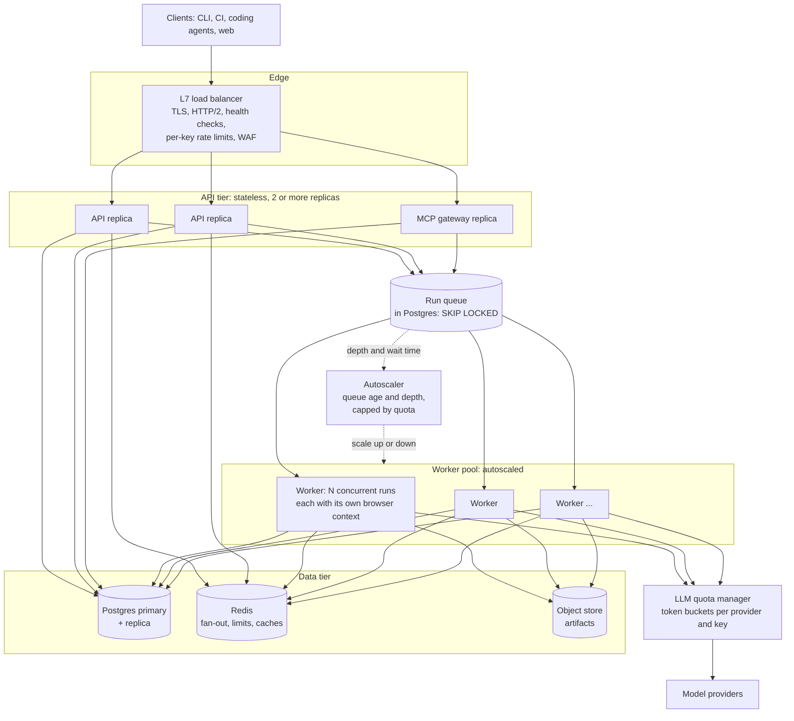
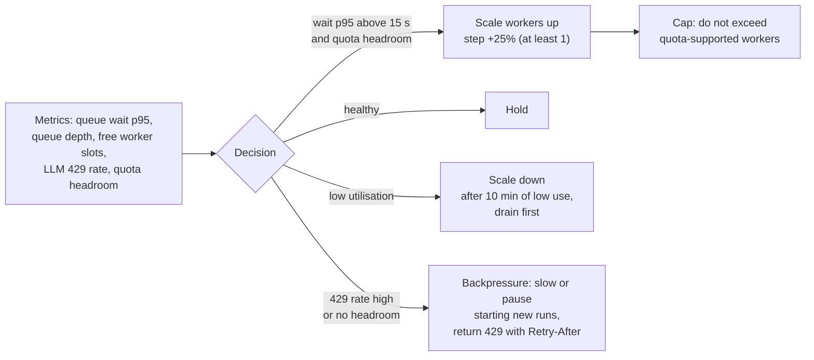

# Scaling and operations

Status: Draft v0.1. **Design only.** Service mode (R5) is documented in full so that nothing in the local-first core makes
it hard later, but it is **built only if there is demand** (see the [roadmap](../03-features-and-roadmap.md)). Every number
below is an **assumption or a formula, not a measurement**; R1 measures the inputs and this file is then updated with real
figures. Satisfies NFR-10 to NFR-12 and FR-90 to FR-95.

## 1. What has to scale, and what really limits it

A test run is a long, mostly *waiting* job: a browser that is idle most of the time, and a model call for each step. That
changes the usual web-scaling intuition:

| Resource | Behaviour | Scales by |
|---|---|---|
| API requests | Few, small, mostly control and polling | Stateless replicas behind a load balancer |
| Event streams | One long-lived connection per watched run | Async servers, fan-out through a broker, resumable by sequence number |
| Run execution | Minutes per run; memory heavy (browser), CPU light | A worker pool, autoscaled on queue age |
| **Model calls** | The dominant **cost and rate limit** | A quota manager with backpressure; fewer tokens per run |
| Storage | Many small events; large artifacts | Partitioned database; object store with lifecycle rules |

**The binding constraint is almost never compute. It is the model provider's rate and token quota** (section 5), then cost.
Designing the scale-out without a quota manager would produce a system that scales workers into rate-limit errors.

## 2. Reference architecture (service mode)

## 3. Load balancing

**What is balanced where.** Only the **API tier** sits behind a load balancer. Workers are balanced by the **queue**
(they *pull* work when they have free capacity), which gives automatic least-loaded behaviour with no balancer and no
central scheduler to fail.

| Topic | Design |
|---|---|
| Layer and product | Layer 7 (HTTP). Managed cloud load balancer in a cloud deployment; Caddy, Traefik or nginx on a single host. No product is committed to before R5 |
| TLS | Terminated at the balancer (TLS 1.2 or newer); automatic certificates where possible |
| Algorithm | Least outstanding requests (round-robin as the fallback). Requests are cheap and uniform; long-lived streams are the imbalance risk, which least-outstanding handles |
| Health | `/readyz` (database and queue reachable) removes a replica from rotation; `/healthz` (process alive) lets the orchestrator restart it |
| Stickiness | **Not required.** Event streams resume from `Last-Event-ID` (the sequence number); the MCP server is stateless. If the chosen MCP SDK keeps in-memory sessions, route by the session header with consistent hashing (the 2026-07-28 MCP draft adds `Mcp-Method` and `Mcp-Name` headers so intermediaries can route without parsing bodies) |
| Long-lived connections | Idle timeout at least 75 s; the server sends a heartbeat comment every 15 s; maximum stream age with graceful reconnect |
| Deploys | Connection draining 120 s; rolling replacement so capacity never drops below N-1 |
| Limits | Request body 1 MB for run creation (artifacts never travel through the API: they use signed upload and download URLs); per-key token-bucket rate limits at the balancer and in the application (Redis) |
| Abuse | WAF managed rules when exposed to the internet; per-tenant quotas |

## 4. The queue and the workers

**Queue.** A `runs` row in state `queued` *is* the queue item. Workers claim with
`SELECT ... FOR UPDATE SKIP LOCKED` ordered by `priority`, then by fair share across tenants (the tenant with the fewest
running runs goes first; deficit round-robin as the refinement), then `created_at`. Because the claim and the state
change are one transaction, there is no separate broker to keep consistent. **Why not Kafka, SQS or RabbitMQ now:** the
rate is low (tens of runs per minute), runs are long, and transactional consistency with run state is worth more than
broker throughput. The trigger to move is in section 11.

**Worker lifecycle.** Claim a run, take a lease (heartbeat every 10 s, lease 60 s), run it, release it. On `SIGTERM`: stop
claiming, let current runs finish or checkpoint (up to 120 s), then exit. A crashed worker's lease expires and the run is
re-queued from its last checkpoint; runs flagged `side_effects: true` are not retried without approval. A run that crashes
workers three times is quarantined (state `error`, reason `poison`) and an alert fires.

**Fairness and priority.** Classes: `interactive` (a person or agent is watching) before `scheduled` before `batch`
(nightly suites). Per-tenant caps on concurrent runs and queued runs prevent one tenant from starving others.

## 5. Capacity model

**Formula.** The sustainable rate is the smallest of three limits:

`runs_per_minute = min( workers x runs_per_worker / run_minutes ,  RPM_quota / calls_per_run ,  TPM_quota / tokens_per_run )`

**Assumptions to be replaced by R1 measurements** (labelled so nobody mistakes them for facts):

| Id | Assumption | Value used | Basis |
|---|---|---|---|
| A1 | Steps per test (median) | 15 | Typical short flows |
| A2 | Seconds per step (model 4 s plus browser 1.5 s) | 5.5 | Observed model latency 1.6 to 17 s on a free tier; paid tiers may differ |
| A3 | Run duration | about 1.5 min (15 x 5.5 s, plus planning and setup) | Within the 3-minute NFR |
| A4 | Model calls per run | 16 | One per step plus planning |
| A5 | Tokens per run | about 65,000 (4,000 in per step: instructions and tool schema 1,200, snapshot 2,000, history 800; plus planning) | Snapshot-driven design |
| A6 | Browser context memory and CPU | 400 MB, 0.3 vCPU average | Typical page |
| A7 | Worker size and concurrency | 4 vCPU, 8 GB, **8 concurrent runs** (memory would allow about 17, CPU about 13: kept conservative) | |
| A8 | Event and artifact volume | about 150 events (about 600 B) per run; about 10 MB of artifacts per run | Screenshots plus trace |

**Worked example (illustrative, not a provider's real limits).**

- One worker: 8 runs / 1.5 min is about 5.3 runs per minute, about 320 per hour.
- Reference target of 1,000 runs per hour needs about 3.1 workers, so **5 with headroom** (30% spare plus one for failure).
- Model load at 1,000 runs per hour: 16,000 calls per hour (about 270 per minute) and about 65 million tokens per hour
  (about 1.1 million per minute).
- If the quota were 1,000 requests and 1,000,000 tokens per minute: the request limit allows about 62 runs per minute,
  the token limit about 15 runs per minute, so **tokens cap throughput near 920 runs per hour no matter how many workers
  exist**. The binding constraint is the model quota.

**Ways to raise the ceiling, in order of leverage:** (1) replay mode (R3) so regression runs use almost no tokens, the
largest lever by far; (2) smaller snapshots (pruning, diffs); (3) cheaper models for easy steps; (4) provider prompt caching
where offered; (5) more quota (higher tier, another key or provider, within the providers' terms); (6) provider batch
interfaces for non-urgent nightly runs, where available.

**Storage.** Events: about 150,000 per hour at the reference rate, a few GB per day; **partition by month**, keep detail for
30 days, keep summary rows longer. Artifacts: about 10 GB per hour at the reference rate (the largest cost): lifecycle rule
of 7 days for passing runs and 30 days for failing runs, configurable.

**API tier.** Stateless; 2 replicas minimum for availability. An async server holds many idle SSE connections (assumed
thousands per replica; to be load-tested). Fan-out across replicas uses Postgres `LISTEN/NOTIFY` first and Redis pub/sub
when notifications become a bottleneck.

## 6. Autoscaling and backpressure

- **Scale on queue age, not CPU.** CPU says little about a job that is mostly waiting on a model.
- **Cap by quota.** Maximum workers = quota-supported concurrency, so autoscaling never turns spare money into rate-limit errors.
- **Quota manager.** Token buckets per provider key for requests and for tokens; workers *reserve* before a call. When
  empty, runs wait briefly (bounded), then the system applies backpressure at the API (`429` with `Retry-After`) rather
  than failing runs midway. Interactive runs have reserved headroom.
- **Circuit breaker** per provider: after repeated failures, route to the fallback model or provider; if all are down,
  new runs wait in the queue and an alert fires; started runs end `error` with an explicit reason, never a false verdict.

## 7. Failure modes and responses

| Failure | Effect | Response |
|---|---|---|
| Worker crashes mid-run | Run stops | Lease expires, run re-queued from checkpoint, attempt counter increments, poison quarantine at 3 |
| API replica dies | Some connections drop | Balancer removes it; clients reconnect and resume by sequence number |
| Postgres primary fails | Writes stop | Automatic failover to the replica (managed service); API returns `503` meanwhile; workers retry with backoff; events already durable are intact |
| Redis unavailable | No fan-out, rate limits unavailable | API falls back to database polling for events and per-replica in-memory rate limits; alert |
| Model provider outage or heavy 429s | Runs cannot progress | Circuit breaker to fallback; backpressure; runs end `error` or wait, never "pass" |
| Object store unavailable | Artifacts not saved | Retry with backoff; if evidence required for the verdict cannot be stored the run ends `error` (evidence is part of the verdict) |
| Thundering herd after an outage | Overload on recovery | Jittered retries; gradual queue release; autoscaler step limits |
| Clock skew | Wrong lease expiry | Leases use database time |
| Bad deploy | Errors rise | Automatic rollback when SLO burn exceeds a threshold during canary |

## 8. Data lifecycle, backup and recovery

- **Retention:** events 30 days (configurable per tenant), summaries 1 year, artifacts 7 or 30 days by outcome.
- **Backups:** Postgres daily base backup plus continuous WAL archiving (point-in-time recovery); object store versioning.
  **Targets: RPO at most 5 minutes, RTO at most 1 hour** (NFR-12). A **restore drill** runs quarterly once service mode
  exists, and the result is recorded.
- **Configuration and infrastructure as code** live in the repository, so an environment can be rebuilt from git.
- **Deletion:** per-tenant deletion removes events, summaries and artifacts and is verified by a test.

## 9. Observability, SLOs and alerts

**Signals.**

- *Metrics (Prometheus):* `runs_total{verdict}`, `run_duration_seconds`, `queue_depth`, `queue_wait_seconds`,
  `worker_slots_free`, `step_duration_seconds`, `llm_latency_seconds`, `llm_tokens_total{direction}`, `llm_errors_total{class}`,
  `cost_estimate_total`, `approval_wait_seconds`, `event_lag_seconds`, `lease_expirations_total`.
- *Traces (OpenTelemetry):* one trace per run, a span per step, per model call, per browser action; the `run_id` is the
  correlation id everywhere.
- *Logs:* structured JSON with `run_id`, `tenant`, `worker`; no secrets or page content.
- *Dashboards:* platform health, queue and capacity, model usage and cost, verdict mix, per-tenant usage.

**SLOs (service mode, monthly):** API availability 99.5%; run start latency (queued to started) p95 at most 15 s at normal
load; event lag p95 at most 2 s. **Verdict correctness is not a live SLO**; it is measured by the evaluation suite
(nightly) because a live system cannot know the truth.

**Alerts (page only for what needs a human now):** queue wait p95 above 5 minutes; error-verdict rate above a threshold;
model 429 rate above a threshold; lease expirations spiking; database replica lag; certificate expiry within 14 days;
error-budget burn above 50% of the month (then new feature work stops until reliability recovers).

## 10. Deployment and rollout

- **Environments:** local, CI, staging, production, each reproducible from the repository.
- **Delivery:** containers built once and promoted unchanged; staging deploys automatically from the main line; production
  deploys on a version tag with a manual approval; canary at 10% then 100% with automatic rollback on SLO breach.
- **Database changes:** expand, migrate, contract (two-step), so any version N and N-1 can run together; the event schema is
  additive.
- **Config and flags:** environment variables validated at start; features behind flags during rollout.
- **Cost control:** per-tenant budgets, a global spend alert, nightly suites capped by a daily token allowance.

## 11. When to build what (triggers, so we do not over-build)

| Step | Trigger to do it |
|---|---|
| Single-host Docker Compose (API, workers, Postgres, object store) | Anyone other than the owner needs hosted runs, or CI needs more than one machine |
| Add Redis | Event fan-out through Postgres notifications or per-replica rate limits become a measured problem |
| Move the queue to Redis or SQS | Claim latency or contention on the `runs` table is measured above target, or runs per minute exceed a few hundred |
| Kubernetes with event-driven autoscaling | Three or more worker hosts, or autoscaling is needed to meet cost or latency goals |
| Multiple regions | Not planned; revisit only with a concrete customer need |

## 12. Load testing without spending tokens

A **synthetic runner** (same queue, leases, events and storage, but scripted instead of a real model and browser) lets the
platform be tested for throughput, fairness, failure recovery and fan-out without model cost. Scenarios: ramp to the
reference rate, soak for 8 hours, spike, worker kill, database restart, Redis loss, a noisy tenant. Tools: k6 or Locust for
the API. Pass criteria are the SLOs above plus: no lost runs, no duplicate events, fair shares within 10%.

## 13. Runbooks to write before R5 ships

Queue growing, workers stuck, model provider degraded, database failover, restore from backup, cost spike, certificate
renewal, poison test quarantined, tenant data deletion. Each uses the [runbook template](../templates/runbook-template.md)
and is followed once in staging before the release.
