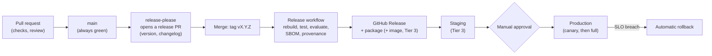

# CI/CD

Status: Draft v0.1. The automated pipeline that protects `main` and ships releases. Policy lives in the
[engineering handbook](engineering-handbook.md); this file defines the pipelines. Deployment (Docker, the VM, service
mode) comes **last**, as decided; it is specified here so the design is complete but it is not built until R5.

## 1. Goals

1. A broken change **cannot** reach `main`.
2. Feedback in **under 10 minutes** for a pull request.
3. Releases are **reproducible**: built by CI from a tag, never from a laptop.
4. **Cheap and safe by default:** pull-request CI makes no real model calls and holds no secrets.
5. The pipeline is code: reviewed, versioned, and documented here.

## 2. Pipelines

| Workflow (file) | Trigger | Jobs | Required to merge |
|---|---|---|---|
| **CI** (`ci.yml`) | Pull request, push to `main` | `lint` (ruff), `types` (mypy), `unit` and `property` tests (Linux and Windows matrix), `contract` tests with a headless browser (Linux; Windows from R2), import-linter, coverage gate, package build; ends with an aggregate `ci-ok` job | Yes (`ci-ok`) |
| **Docs** (`docs.yml`) | Pull request, push to `main` | `python tools/check_docs.py` (ADR index in sync, no orphan documents, no broken internal links, status file fresh); Markdown and Mermaid validation | Yes |
| **Security** (`security.yml`) | Pull request, weekly schedule | CodeQL analysis, dependency review (fails on high-severity or licence problems), secret scan; later container scan | Yes (from Tier 1) |
| **Nightly evaluation** (`eval-nightly.yml`) | Schedule, manual dispatch | The evaluation subset with the **real model** under a token budget; uploads the manifest and aggregate results as artifacts; opens an issue if a bar regresses | No (informational; blocks release if red) |
| **Release** (`release.yml`) | Tag `v*` | Rebuild from the tag, run the full CI and the full evaluation, build the package (and container from Tier 3), generate SBOM and provenance, create the GitHub Release with notes | n/a |
| **Deploy staging / production** (`deploy-*.yml`) | Main (staging); release tag with approval (production) | Pull the **same** image that was built and scanned, migrate, roll out, smoke test, automatic rollback on SLO breach | Environment protection |
| **Dependabot** | Weekly | Pull requests for dependencies and for GitHub Actions | They go through CI like any change |

**The aggregate job.** Required checks can be skipped by path filters and then block merging forever. The `ci-ok` job runs
last with `if: always()`, inspects the result of every job it depends on, and fails if any failed or was cancelled. Only
`ci-ok` and `docs` are marked required in branch protection, which keeps the rule stable as jobs change.

## 3. Conventions for every workflow

- **Permissions:** `permissions: contents: read` at the top; a job asks for more (`pull-requests: write`, `id-token: write`)
  only when it needs it.
- **Pinned actions:** the target is every action referenced by **commit SHA** with a comment naming the version, kept current
  by Dependabot. **Today they use major-version tags** (`@v4`, `@v5`): converting them to SHAs is a Tier 1 task to be done with a
  tool (for example `pinact`) so no SHA is ever typed from memory.
- **Concurrency:** one run per branch; a newer push cancels the older in-progress run (never for `main` or release runs).
- **Caching:** dependency and browser caches keyed on the lock file; a cache miss is slower, never wrong.
- **Timeouts:** every job has `timeout-minutes`.
- **Secrets:** none in pull-request CI. Real model keys exist only in the nightly and release environments, scoped, rotated,
  and spent under a budget. Cloud access uses **OIDC**, not stored credentials.
- **Reproducibility:** pinned runner images (`ubuntu-24.04`, `windows-2022`), locked dependencies, a recorded Playwright
  browser version.
- **Artifacts:** test reports, coverage, evaluation manifests and traces are uploaded with a retention of 14 days (90 for
  releases); nothing from private data sets is ever uploaded.
- **Flaky tests:** one automatic rerun is allowed and **reported**; a test that needed it is labelled flaky, quarantined
  behind a marker within 24 hours, and has an issue. Quarantined tests still run, but do not block, and the count is a
  health metric.
- **Failure messages are for humans:** each job prints how to reproduce locally (the exact command).

## 4. Adoption tiers

| Tier | When | What exists |
|---|---|---|
| **0** (exists today) | Now | `ci.yml`: backend ruff and pytest, evals tests, client syntax and history tests. **Has never run on GitHub** |
| **1** | R0 (this plan) | `docs.yml` and `tools/check_docs.py`; PR and issue templates; CODEOWNERS; Dependabot; `ci-ok` aggregate; `SECURITY.md`; branch protection applied; action SHA pinning; CodeQL and dependency review |
| **2** | R1 to R2 | New package CI: types, matrix, contract tests in a real browser, import-linter, coverage gate; nightly evaluation; release workflow with release-please and trusted publishing of the package |
| **3** | R5 (on demand) | Container build, scan (Trivy) and SBOM; staging and production deploy with environment approvals; synthetic load test job; provenance attestations; DORA metrics |

Each tier is complete and useful on its own; the next is added only when its trigger in the roadmap is reached.

### Where Tier 1 stands (updated with each change to this file)

| Item | State |
|---|---|
| `docs.yml`, `tools/check_docs.py` and its tests | Built and tested locally (validated YAML; the workflow itself has not run on GitHub) |
| `ci-ok` aggregate job and concurrency, permissions, timeouts in `ci.yml` | Built; YAML validated; **not yet run on GitHub** |
| Issue forms, PR template, CODEOWNERS, Dependabot, `SECURITY.md` | Built; YAML and issue-form structure validated |
| Branch protection and repository settings | **Pending**: manual, applied after the first push using the handbook checklist |
| Action SHA pinning | **Pending**: needs a tool, after the first push |
| CodeQL and dependency review | **Pending, blocked by OQ-12**: they need the repository to be public, or GitHub Advanced Security on a private one |
| Types job (mypy) | Pending: there is no new package to type-check until R1 |

## 5. Required status checks (names to put in branch protection)

From Tier 1: `ci-ok`, `docs`, `codeql`, `dependency-review`. The job names are stable on purpose; renaming one requires
updating the protection rule in the same change and a note in the pull request.

## 6. The release path

## 7. Rollback and recovery

- **Code:** revert the pull request (squash merges make this one commit); release a patch version.
- **Deployment (Tier 3):** redeploy the previous image tag (kept for at least 30 days); database changes follow
  expand-migrate-contract so a rollback never needs a data restore.
- **A broken pipeline** is fixed like any bug, with priority P0 when it blocks `main`; a temporary bypass is never used.

## 8. Cost and capacity of CI

A pull-request run should cost nothing in model fees. The real-model nightly run is bounded by a daily token allowance and
stops cleanly with a partial report rather than overspending; the allowance and the spend are visible in the run summary.
GitHub-hosted minutes are the other cost: keep the pull-request path small, move slow work to nightly, and review minutes monthly.

## 9. Measuring the pipeline

Track: median and p95 pull-request duration, queue time, cache hit rate, flaky-test count, time from merge to release, and
(Tier 3) deployment frequency, change failure rate and time to restore. Review monthly; a metric is a prompt to look, not a
target to game.
