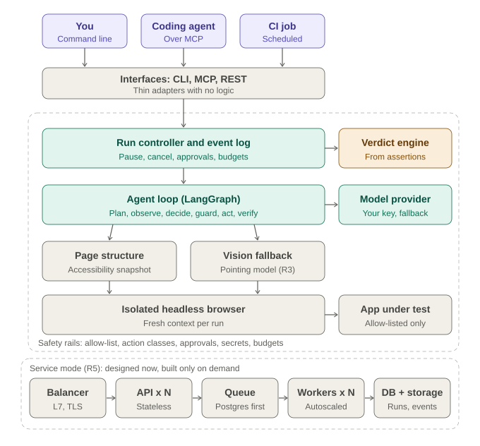

# Review brief (one page)

Status: Draft v0.1 for outside review. Full detail: [start here](00-START-HERE.md).

## The idea

An **AI test agent**. You describe a test in plain English; the agent runs it in an isolated, headless browser in the
background (so nothing on your screen is disturbed) and returns **passed, failed, inconclusive, blocked or error** with
evidence: screenshots, a trace and a step log. The verdict is **computed from assertions that were actually executed**, never
from the model's opinion, so it cannot simply claim success. It works **standalone** (command line, CI) or **supervised by a
coding agent over MCP**; who supervises (autonomous, an agent, or a human) is a setting, not a different product.

## The design

One core engine, thin adapters (CLI, MCP, REST), every run recorded as an append-only **event log**, safety rails around
everything. It runs in one process locally and in CI; a scalable **service mode** (load balancer, stateless API, queue,
autoscaled workers, Postgres and object storage, model-quota manager) is fully designed and built only on demand.
Details: [high-level design](04-architecture/hld.md), [low-level design](04-architecture/lld.md),
[scaling and operations](04-architecture/scaling-and-operations.md), [security](04-architecture/security-threat-model.md).

## How it will be managed

- **Docs are the memory.** Everything lives in the repository: `AGENTS.md` (rules for any AI agent), a status file, one
  decision record per decision, pre-registered experiments, lessons learned. A "cold-start drill" proves a fresh agent can
  resume from the repository alone. A script in CI checks the mechanical parts.
- **GitHub, properly.** Trunk-based development, short-lived branches, squash-merged pull requests with a checklist,
  Conventional Commits, protected `main`, issue templates, milestones per release, Dependabot, code scanning, secret
  scanning, signed releases built by CI.
- **CI/CD in tiers.** Lint, types, tests, docs check, security on every change; real-model evaluation nightly under a token
  budget; releases built from tags; containers and deployment last.
- **Measure before building.** Pass bars are frozen before any result exists, including the false-pass rate; releases have
  exit gates with kill criteria.

## What feedback is most valuable

1. Is "computed verdict from recorded assertions" the right trust model, or is something missing?
2. Is the first-release scope (web only, local, command line) small enough to finish and still useful?
3. Is the pass bar (clean pass at least 90%, bugs caught at least 80%, false pass at most 15%) sensible?
4. Which security risk have we missed (prompt injection, secrets, the supervision channel)?
5. Is the process proportionate for one person, or is something theatre?
6. Is the service-mode design reasonable, and are the triggers for building it sensible?
